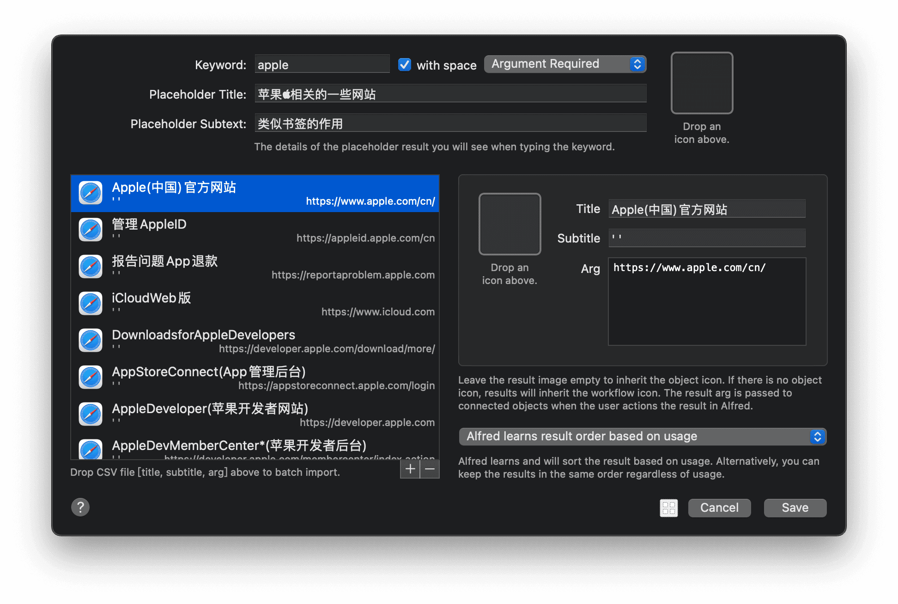

# Markdown链接文本转csv处理




利用`Alfred`的`ListFilter`功能做网络书签 

`markdown`格式的链接文本文件  =>  `csv`格式文本文件

```markdown
- [Apple (中国) - 官方网站](https://www.apple.com/cn/)
- [管理Apple ID](https://appleid.apple.com/cn)
- [报告问题 App退款](https://reportaproblem.apple.com)

Apple (中国) - 官方网站,' ', https://www.apple.com/cn/
管理Apple ID, ' ', https://appleid.apple.com/cn
报告问题 App退款 , ' ', https://reportaproblem.apple.com
```


`Alfred`获取`markdown`文本文件的路径,利用`bash`逐行读取转一下格式再写入`csv`文件即可实现

```bash
#! /bin/bash
echo "原文本 => "
echo '
- [百度] (https://www.baidu.com)

- [百度 ](https://www.baidu.com)

- [ 百 度](https://www.baidu.com)
- [百度 ](https://www.baidu.com)

- [百 度 ](https://www.baidu.com)
- [百度 ] (https://www.baidu.com)
- [百度]( https://www.baidu.com)

- [百度](https://www.baidu.com )
- [百度](https://www.baidu.com)
- [百度]( https://www.baidu.com )

- [tengxun (哈哈哈)](https://www.tententxin.com )
- [[sina]事实上啊啊(牛啊)](https://www.sina.com)
- [souhu(哈哈哈)]( https://www.baidu.com )

'
echo "处理后的文本 => "
echo '
百度,' ',https://www.baidu.com
百度,' ',https://www.baidu.com
百度,' ',https://www.baidu.com
百度,' ',https://www.baidu.com
百度,' ',https://www.baidu.com
百度,' ',https://www.baidu.com
百度,' ',https://www.baidu.com
百度,' ',https://www.baidu.com
百度,' ',https://www.baidu.com
百度,' ',https://www.baidu.com
tengxun (哈哈哈),' ',https://www.tententxin.com
[sina]事实上啊啊(牛啊),' ',https://www.sina.com
souhu(哈哈哈),' ',https://www.baidu.com
'
echo "然后追加写入到 ~/Desktop/result.csv 文件中"

function getURL() {
    title_right=${1#*[}
    title=${title_right%]*}
    link_right=${1##*(}
    link=${link_right%%)*}
    result="${title},' ',${link}"
}

for line in `cat $1 | tr -d " "|tr -d "-" | tr -s "\n"`
do
    getURL $line
    echo $result >> ~/Desktop/result.csv
done

echo "写入完成~"
exit 0
```

